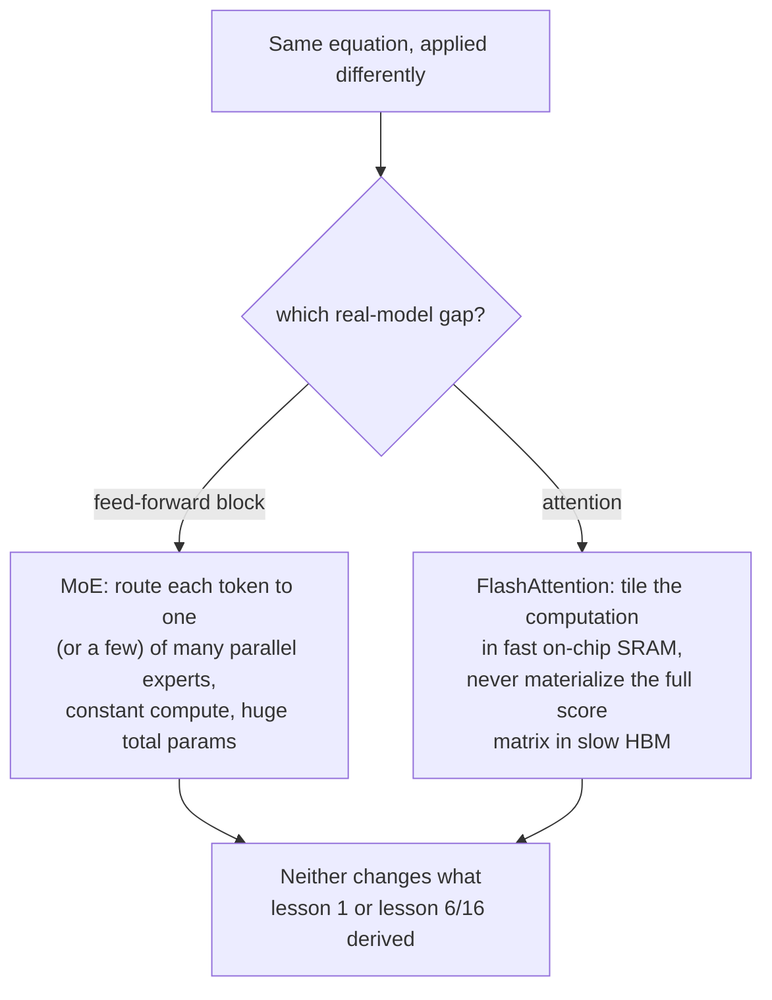

# Урок 22. Смесь экспертов и FlashAttention

**Связь с целью курса:** Каждый урок этого рабочего пространства выводил одно плотное вычисление, применяемое одинаково к каждому токену: один feed-forward-блок, одно вычисление внимания, выполняемые одинаково независимо от входа. Настоящие большие модели нарушают оба допущения так, что базовая математика, построенная в этом рабочем пространстве, не меняется: **смесь экспертов** (mixture-of-experts, MoE) направляет разные токены через разные параметры, а не через одни и те же, а **FlashAttention** вычисляет в точности уравнение из урока 1 с совершенно иными, более быстрыми отношениями с памятью GPU. Ни то ни другое не новая операция; оба это иной способ выполнять уже выведенные операции.
**Первоисточник:** [Научная статья: "FlashAttention: Fast and Memory-Efficient Exact Attention with IO-Awareness", Dao et al., 2022](https://arxiv.org/abs/2205.14135)
**Предварительные требования:** [Урок 1](0001-scaled-dot-product-attention.md), [Урок 16](0016-swiglu-and-the-gated-feed-forward.md)

## Разминка

1. ▢ Почему feed-forward-блок этого рабочего пространства применяет одни и те же матрицы весов к вектору каждой позиции независимо и что SwiGLU меняет в этом вычислении?

Проверка

Применение одних и тех же весов к каждой позиции (без смешивания между позициями) и делает блок позиционным, дополняя роль внимания по смешиванию между позициями. SwiGLU меняет внутреннее вычисление (конструкция с вентилем и двумя повышающими проекциями), но не эту позиционную структуру; он по-прежнему применяется одинаково к каждой позиции.

2. ▢ Запишите по памяти уравнение масштабированного скалярного внимания.

Проверка

`Attention(Q, K, V) = softmax(QK^T / sqrt(d_k)) V`.

## Что нужно знать

### Обычные модели тратят одинаковые вычисления на каждый токен; MoE нет

Каждый feed-forward-блок, построенный в этом рабочем пространстве (урок 6, урок 16), повторно использует в точности одни и те же параметры для каждого токена, который через него проходит. Слой **смеси экспертов** (mixture-of-experts, MoE) заменяет этот единый feed-forward-блок несколькими параллельными копиями, называемыми **экспертами**, плюс небольшой **роутер** (router), который выбирает, какой эксперт (или эксперты) на самом деле обрабатывает данный токен. Формулировка самой Switch Transformer прямо называет получающийся компромисс: модель становится **разреженно активируемой**, с непомерно большим общим числом параметров, распределённым по всем её экспертам, но с примерно **постоянной вычислительной стоимостью на токен**, потому что для данного токена на самом деле работают только выбранные роутером эксперты, а не все.

### Больше параметров без большего объёма вычислений на токен это совершенно иной рычаг масштабирования

Это разделяет две вещи, которые обычно жёстко связаны: общее число параметров плотной модели и вычислительная стоимость обработки одного токена растут вместе, поскольку каждый параметр затрагивает каждый токен. Модель MoE может увеличить общее число параметров, добавляя экспертов, не увеличивая того, во сколько обходится обработка любого отдельного токена, потому что добавление эксперта лишь добавляет ещё один вариант, который роутер может выбрать, а не больше работы, которую должен проделать каждый токен. Конкретное упрощение Switch Transformer, направление каждого токена ровно одному эксперту вместо объединения нескольких, было выбрано именно чтобы сократить затраты на коммуникацию и потери стабильности обучения, с которыми сталкивались более ранние, более сложные конструкции MoE, и статья сообщает, что это позволило разреженным моделям масштабироваться до триллиона параметров с многократным ускорением предобучения по сравнению с эквивалентной плотной моделью.

### FlashAttention не меняет уравнение внимания, а меняет то, как оно обращается к памяти

Время и память самовнимания растут квадратично с длиной последовательности, поскольку запрос каждой позиции должен сравниваться с каждым ключом. Диагноз самой статьи о том, почему из-за этого реальные реализации медленны, не в самом уравнении, а в том, что наивная реализация материализует полную, квадратично большую матрицу оценок внимания в большой, но медленной основной памяти GPU (HBM), а затем читает её обратно для softmax и итоговой взвешенной суммы, и именно эти чтения и записи в медленную память, а не арифметика, доминируют в реальном времени работы. **FlashAttention** явно **учитывает ввод-вывод** (IO-aware): она перестраивает то же вычисление с помощью **разбиения на плитки** (tiling), обрабатывая небольшие фрагменты последовательности целиком внутри небольшой, но быстрой встроенной памяти GPU (SRAM), так что полная матрица оценок вообще никогда не записывается в медленную память.

### Точно, а не приближённо: тот же результат другим путём

Статья подчёркивает, что FlashAttention вычисляет **точное** внимание, в точности уравнение из урока 1, `softmax(QK^T / sqrt(d_k)) V`, без математических упрощений и без размена качества, в отличие от прежних методов приближённого внимания, с которыми статья себя сопоставляет и которые, как отмечают авторы, часто не давали реального ускорения по времени работы, хотя и снижали номинальную вычислительную сложность. Настоящий вклад FlashAttention целиком в вводе-выводе: меньше чтений и записей памяти между HBM и SRAM для идентичного математического результата, и именно поэтому при чтении кода реальных моделей встречается реализация внимания, структурно непохожая на прямолинейную версию из урока 1, но по-прежнему обязанная выдавать тот же результат, который вывел урок 1.

## Практика

1. ▢ Плотная модель удваивает число параметров своего feed-forward-блока, и вычислительная стоимость каждого токена через этот блок тоже примерно удваивается. Модель MoE удваивает общее число параметров экспертов, добавляя больше экспертов. Удваивается ли вычислительная стоимость каждого токена тоже?

Подсказка

Подумайте, что на самом деле выбирает роутер для данного токена, сколько бы всего экспертов ни существовало.

Проверка

Нет. Добавление экспертов лишь добавляет больше вариантов, из которых роутер может выбирать; вычислительная стоимость токена зависит от того, к скольким экспертам он на самом деле направлен (к одному в Switch Transformer), а не от общего числа существующих экспертов. Общее число параметров и вычислительная стоимость на токен разделены так, как у плотной модели не разделены.

2. ▢ Почему Switch Transformer направляет каждый токен ровно одному эксперту, а не объединяет нескольких, как это делали более ранние конструкции MoE?

Проверка

Формулировка самой статьи говорит, что это было выбрано именно чтобы сократить затраты на коммуникацию и вычисления и нестабильность обучения, с которыми сталкивалась более сложная маршрутизация по нескольким экспертам, упростив алгоритм маршрутизации и сохранив при этом свойство разреженной активации и постоянной стоимости на токен.

3. ▢ Почему наивная реализация внимания становится медленной именно на длинных последовательностях, согласно собственному диагнозу FlashAttention?

Проверка

Полная матрица оценок внимания растёт квадратично с длиной последовательности, а наивная реализация материализует всю эту матрицу в большой, но медленной основной памяти GPU (HBM), а затем читает её обратно для softmax и взвешенной суммы; именно эти чтения и записи памяти, а не сама арифметика, доминируют в реальном времени работы по мере роста матрицы.

4. ▢ Вычисляет ли FlashAttention иную, приближённую версию внимания, чтобы достичь ускорения, как это делали некоторые прежние методы?

Проверка

Нет. FlashAttention явно точная и вычисляет математически тот же результат, что и уравнение из урока 1; её ускорение целиком даёт учёт ввода-вывода: разбиение вычисления на плитки, чтобы оставаться в быстрой встроенной памяти и не материализовать полную матрицу оценок в медленной памяти, а не какое-либо приближение или размен качества.

5. ▢ Какое утверждение правильно описывает, что MoE и FlashAttention каждая меняют в математике, выведенной в этом рабочем пространстве?

    - a) MoE меняет уравнение внимания, а FlashAttention меняет уравнение feed-forward-блока
    - b) MoE разделяет общее число параметров и вычислительную стоимость на токен, направляя токены в подмножество параллельных экспертных feed-forward-блоков; FlashAttention вычисляет точное, неизменное уравнение внимания, но перестраивает доступ к памяти, чтобы не материализовать полную матрицу оценок в медленной памяти GPU
    - c) FlashAttention приближает внимание, меняя качество на скорость, так же как более ранние методы, которые она улучшает
    - d) Ни MoE, ни FlashAttention ничего не меняют в том, сколько всего вычислений требует запуск обучения

Проверка

**b)** Это точные, не пересекающиеся изменения, которые вносит каждая техника. Вариант (a) неверен: MoE затрагивает feed-forward-блок, а не внимание; FlashAttention затрагивает внимание, а не feed-forward-блок. Вариант (c) неверен: FlashAttention явно точная, в отличие от приближённых методов, с которыми её сопоставляют. Вариант (d) неверен: MoE меняет вычисления на токен относительно общего числа параметров, а FlashAttention меняет стоимость по времени работы через эффективность памяти; обе заметно влияют на реальные вычислительные затраты, просто не на математический результат.

## Практика в реальной работе

- [ ] Для модели, к которой у вас есть доступ (или по опубликованным деталям её архитектуры), проверьте, использует ли она плотный feed-forward-блок или слой смеси экспертов, и если MoE, то сколько экспертов и сколько из них активируется на токен.
- [ ] Проверьте, предоставляет ли используемая вами библиотека (например, `transformers`) реализацию FlashAttention как опцию и какой выигрыш в скорости или памяти она заявляет по сравнению со стандартной реализацией внимания на длинных последовательностях.
- [ ] Завтра: прочитайте целиком анализ IO-сложности в статье про FlashAttention и отметьте, как число обращений к HBM, которое она требует, математически соотносится с числом обращений у стандартного внимания.

## Что почитать дальше

- [Научная статья: "FlashAttention: Fast and Memory-Efficient Exact Attention with IO-Awareness", Dao et al., 2022](https://arxiv.org/abs/2205.14135)
- [Научная статья: "Switch Transformers: Scaling to Trillion Parameter Models with Simple and Efficient Sparsity", Fedus, Zoph, and Shazeer, 2021](https://arxiv.org/abs/2101.03961)
- [Научная статья: "Attention Is All You Need", Vaswani et al., 2017](https://arxiv.org/abs/1706.03762)
- [Ресурсы](../RESOURCES.md)

---

Не доходит? Перечитайте первоисточник в начале: этот урок его сжимает, а при сжатии понимание как раз и теряется. Загляните в [глоссарий](../GLOSSARY.md), если какой-то термин показался скользким.

Если неясен сам урок, а не материал, это дефект: [откройте issue](https://github.com/TokenCemetery/teach/issues).
