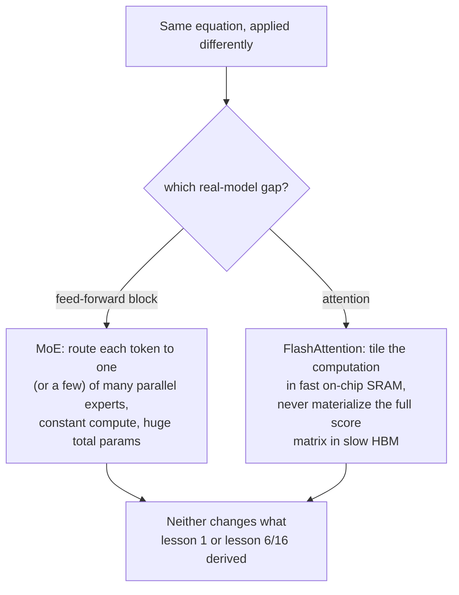

# 第 22 课：混合专家与 FlashAttention

**使命关联:** 这个工作区的每一课，推导的都是一种均匀地作用于每个 token 的稠密计算，一个前馈块，一次注意力计算，不论输入是什么，运行方式都相同。真实的大模型以几种方式打破了这两条假设，却从未改变这个工作区所搭建的底层数学：**混合专家**（MoE）把不同的 token 路由经过不同的参数，而不是同样的参数，**FlashAttention** 则以与 GPU 内存完全不同的、更快的关系，计算出第 1 课完全相同的方程。两者都不是新的运算；都是运行已经推导出来的运算的另一种方式。
**主要来源:** [论文：“FlashAttention: Fast and Memory-Efficient Exact Attention with IO-Awareness”，Dao 等，2022](https://arxiv.org/abs/2205.14135)
**前置知识:** [第 1 课](0001-scaled-dot-product-attention.md)、[第 16 课](0016-swiglu-and-the-gated-feed-forward.md)

## 热身

1. ▢ 为什么这个工作区的前馈块，把同样的权重矩阵独立地作用于每个位置的向量？SwiGLU 又改变了这个计算的什么？

检查

把同样的权重作用于每个位置（没有跨位置的混合），正是使这个块成为逐位置的原因，与注意力在位置之间混合的角色互补。SwiGLU 改变的是内部的计算（一种带门控的、有两个向上投影的设计），而不是这种逐位置的结构；它仍然相同地作用于每个位置。

2. ▢ 凭记忆写出缩放点积注意力的方程。

检查

`Attention(Q, K, V) = softmax(QK^T / sqrt(d_k)) V`。

## 要点

### 普通的模型在每个 token 上花同样的计算；MoE 不是

这个工作区搭建的每一个前馈块（第 6 课、第 16 课），对经过它的每个 token 都复用完全相同的参数。**混合专家**（MoE）层用几个并行的副本，称为**专家**，加上一个小的**路由器**，来取代那个单一的前馈块，由路由器选择实际处理某个 token 的专家（一个或几个）。Switch Transformer 自己的表述直接陈述了由此产生的取舍：模型变成**稀疏激活**的，总参数量大得惊人，分散在它所有的专家里，却有**每个 token 的计算成本大致恒定**，因为对那个 token 实际运行的，只有路由器选中的专家，而不是全部。

### 更多的参数而不增加每个 token 的计算，是一种完全不同的缩放杠杆

这把通常锁在一起的两件事解耦了：稠密模型的总参数量和处理一个 token 的计算成本，是一起缩放的，因为每个参数都会接触每个 token。MoE 模型可以通过增加专家来增加总参数量，而不增加处理任何单个 token 的成本，因为增加一个专家，只是增加了路由器可能挑选的另一个选项，而不是每个 token 都得做更多的工作。Switch Transformer 具体的简化做法，是把每个 token 恰好路由给一个专家，而不是组合几个，这是专门为了减少更早的、更复杂的 MoE 设计所遇到的通信成本和训练稳定性问题而选择的，论文报告说，这让稀疏模型得以缩放到万亿参数的范围，相比同等的稠密模型，预训练速度提升了好几倍。

### FlashAttention 并不改变注意力的方程，它改变的是这个方程访问内存的方式

自注意力的时间和内存成本，随序列长度呈二次方增长，因为每个位置的查询都要与每个键做比较。论文自己对为什么这会让真实的实现变慢的诊断，问题不在方程本身，而在于朴素的实现，会把完整的、规模呈二次方增长的注意力分数矩阵，实体化在 GPU 容量大但速度慢的主内存（HBM）里，再把它读回来做 softmax 和最后的加权求和，决定实际耗时的，是这些对慢速内存的读写，而不是算术。**FlashAttention** 明确是**感知 IO** 的：它用**分块**来重构同一个计算，每次完全在 GPU 容量小但速度快的片上内存（SRAM）里处理序列中的一小块，所以完整的分数矩阵根本不会被写出到慢速内存里。

### 精确，而不是近似：相同的输出，不同的路径

论文明确指出，FlashAttention 计算的是**精确**的注意力，也就是第 1 课的那个确切的方程，`softmax(QK^T / sqrt(d_k)) V`，没有任何数学上的捷径或质量上的取舍，这与论文拿来对照的先前近似注意力方法不同，作者指出，那些方法尽管降低了名义上的计算复杂度，却往往没能带来真正的实际耗时加速。FlashAttention 真正的贡献纯粹关乎 IO：为了同样的数学结果，减少 HBM 与 SRAM 之间的内存读写，这正是为什么阅读真实的模型代码时，看到的注意力实现在结构上与第 1 课直截了当的版本不同，却仍然必须产生第 1 课推导出的同样的输出。

## 练习

1. ▢ 一个稠密模型把它的前馈块的参数量翻倍，每个 token 经过这个块的计算成本也大致翻倍。一个 MoE 模型通过增加专家，把它的专家总参数量翻倍。每个 token 的计算成本也会翻倍吗？

提示

想一想，不论总共有多少个专家，路由器实际上为某个 token 选择了什么。

检查

不会。增加更多专家，只是增加了路由器可能从中挑选的选项；一个 token 的计算成本，取决于它实际被路由到多少个专家（对 Switch Transformer 来说是一个），而不取决于存在的专家总数。总参数量和每个 token 的计算成本，以一种稠密模型做不到的方式被解耦了。

2. ▢ 为什么 Switch Transformer 把每个 token 恰好路由给一个专家，而不是像更早的 MoE 设计那样组合几个？

检查

论文自己的表述说明，这样选择，是专门为了减少更复杂的多专家路由所遇到的通信和计算成本，以及训练的不稳定性，简化了路由算法，同时仍然保持稀疏激活、每个 token 成本恒定的性质。

3. ▢ 按照 FlashAttention 自己的诊断，朴素的注意力实现为什么偏偏在序列很长时变慢？

检查

完整的注意力分数矩阵随序列长度呈二次方增长，而朴素的实现会把整个矩阵实体化在 GPU 容量大但速度慢的主内存（HBM）里，再把它读回来做 softmax 和加权求和；随着矩阵增大，决定实际耗时的，是这些内存读写，而不是算术本身。

4. ▢ FlashAttention 是否像先前的一些方法那样，通过计算一个不同的、近似的注意力版本来获得加速？

检查

没有。FlashAttention 明确是精确的，计算出与第 1 课的方程完全相同的数学结果；它的加速完全来自感知 IO，即把计算分块，使其留在快速的片上内存里，避免在慢速内存里实体化完整的分数矩阵，而不是来自任何近似或质量上的取舍。

5. ▢ 下面哪一项说法正确描述了 MoE 和 FlashAttention 各自对这个工作区所推导的数学改变了什么？

    - a) MoE 改变了注意力的方程，FlashAttention 改变了前馈块的方程
    - b) MoE 通过把 token 路由给一部分并行的专家前馈块，把总参数量与每个 token 的计算成本解耦；FlashAttention 计算的是注意力那个精确的、没有改变的方程，但重构了内存访问，避免在慢速的 GPU 内存里实体化完整的分数矩阵
    - c) FlashAttention 近似注意力，用质量换取速度，就像它所改进的那些更早的方法一样
    - d) MoE 和 FlashAttention 都没有改变一次训练运行所需的总计算量

检查

**b)** 这正是每种技术所做的、互不重叠的改变。(a) 是错的：MoE 影响的是前馈块，而不是注意力；FlashAttention 影响的是注意力，而不是前馈块。(c) 是错的：FlashAttention 明确是精确的，与拿来对照的近似方法不同。(d) 是错的：MoE 改变了每个 token 的计算相对于总参数量的比例，FlashAttention 通过内存效率改变了实际耗时的成本；两者都实实在在地影响了真实的计算成本，只是不影响数学结果。

## 实战练习

- [ ] 对一个你能接触到的模型（或它公布的架构细节），检查它用的是稠密的前馈块还是混合专家层，如果是 MoE，有多少个专家，每个 token 激活其中多少个。
- [ ] 检查你在用的某个库（比如 `transformers`）是否把 FlashAttention 实现作为一个选项提供出来，并看它在长序列下，相比标准的注意力实现，报告了怎样的速度或内存收益。
- [ ] 明天：完整阅读 FlashAttention 论文的 IO 复杂度分析，并记下它所需的 HBM 访问次数，在数学上与标准注意力的相比如何。

## 延伸阅读

- [论文：“FlashAttention: Fast and Memory-Efficient Exact Attention with IO-Awareness”，Dao 等，2022](https://arxiv.org/abs/2205.14135)
- [论文：“Switch Transformers: Scaling to Trillion Parameter Models with Simple and Efficient Sparsity”，Fedus、Zoph 和 Shazeer，2021](https://arxiv.org/abs/2101.03961)
- [论文：“Attention Is All You Need”，Vaswani 等，2017](https://arxiv.org/abs/1706.03762)
- [资源](../RESOURCES.md)

---

没学明白？请重读顶部的主要来源，因为本课是对它的压缩，而理解正是在压缩中流失的。如果有哪个术语觉得含糊，可以查看[术语表](../GLOSSARY.md)。

如果问题出在课程本身，而不是学习材料，那就是一个缺陷：[提交 issue](https://github.com/TokenCemetery/teach/issues)。
